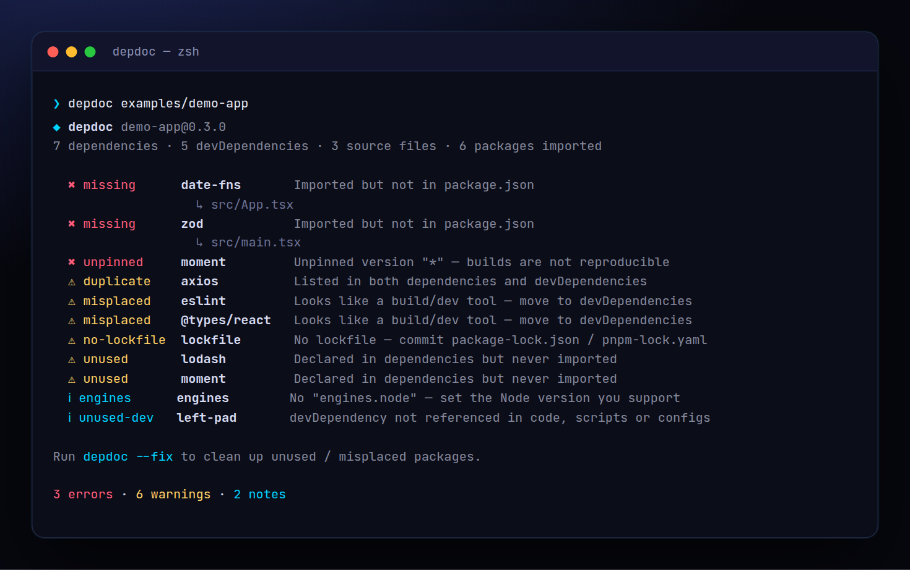

<!-- ═════════════ HEADER ═════════════ -->
<p align="center">
  
</p>

<p align="center">
  
</p>

<p align="center">
  <a href="https://github.com/krishyaa06/prism-dep-doctor/actions/workflows/ci.yml"></a>
  
  
  <a href="LICENSE"></a>
</p>

<p align="center">
  
</p>


## ⚡ Overview

**Prism Dep Doctor** (`depdoc`) reads every `import`, `require()` and dynamic `import()` in your JS / TS / Vue / Svelte code and compares it with `package.json`. It catches the classic AI-coding mistake — code that imports `zod` or `date-fns` which was never installed — plus dependencies nobody uses anymore, build tools sitting in `dependencies`, packages listed twice, and `*` / `latest` versions. `depdoc --fix` cleans `package.json` for you.

## ✨ Features

- **missing**: imported in code but not declared (with file locations)
- **unused**: declared but never imported — knows about CLI tools in `scripts` and plugins in config files
- **misplaced**: `eslint`, `vite`, `@types/*`, test runners in `dependencies`
- **duplicate** and **unpinned** (`*`, `latest`) versions, git / local deps, lockfile + `engines` checks
- `--fix` removes unused and moves misplaced packages, preserving your formatting
- `--outdated` checks the npm registry; `--json`, `--strict`, `--ignore`. Monorepo-aware (skips nested packages)

## 🚀 Quick Start

```bash
# run without installing
npx github:krishyaa06/prism-dep-doctor 

# or install globally
npm install -g github:krishyaa06/prism-dep-doctor
depdoc --fix
```

Requires Node.js 18.17+. No dependencies.

## 🛠️ Usage

```text
depdoc [dir] [options]

    --fix              remove unused, move misplaced (writes package.json)
    --outdated         also check npm for newer versions (network)
    --ignore <list>    packages to skip, e.g. react-dom,@scope/*
    --strict           warnings fail too (exit 1)
    --json             machine-readable output
```

### Checks

| Level | Check | Meaning |
|---|---|---|
| error | `missing` | imported in code but not in package.json |
| error | `unpinned` | `*` / `latest` / empty version |
| warn | `unused` | in dependencies, never imported or referenced |
| warn | `misplaced` | build / dev tool in dependencies |
| warn | `duplicate` | in both dependencies and devDependencies |
| warn | `no-lockfile` / `multi-lockfile` | lockfile hygiene |
| info | `unused-dev`, `git`, `local`, `engines` | worth a look |

### In CI

```yaml
- run: npx --yes github:krishyaa06/prism-dep-doctor
```

## 📁 Project Structure

```text
prism-dep-doctor/
├── assets/
│   ├── logo.png
│   └── logo.svg
├── bin/
│   └── depdoc.js   # CLI entry
├── examples/
│   └── demo-app/   # project with every problem
│       ├── src/
│       │   ├── App.tsx
│       │   └── main.tsx
│       ├── test/
│       │   └── app.test.ts
│       └── package.json
├── src/
│   ├── index.js   # import parser, analyzer, fixer
│   ├── ui.js   # colours, tables
│   └── walk.js   # gitignore-aware walker
├── test/
│   └── depdoc.test.js
├── .gitignore
├── LICENSE
├── README.md
└── package.json
```

## 🧪 Tests

```bash
npm test
```

Tests use the built-in `node:test` runner, so there is nothing to install. CI runs them on Node 20 and 22.

## 🤝 Contributing

1. Fork the repo and create a branch: `git checkout -b feature/my-idea`
2. Make your change and add a test in `test/`
3. Run `npm test` and open a Pull Request

## 🔷 Part of Prism Protocol

Prism Dep Doctor is one of the open-source tools built by [Prism Protocol](https://dc.gg/prismprotocol), a tech community where young builders learn, ship and compete together.

## 👤 Author

<table>
  <tr>
    <td align="center">
      <a href="https://github.com/krishyaa06"><br><b>Soumya Bhandare</b></a><br>
      <sub>Founder @ Prism Protocol</sub>
    </td>
    <td>
      <a href="https://dc.gg/prismprotocol"></a><br>
      <a href="https://instagram.com/prism_protocol_"></a><br>
      <a href="https://x.com/krishyaa06"></a>
    </td>
  </tr>
</table>

## 📄 License

Released under the [MIT License](LICENSE).

<p align="center">
  <b>If you like this project, consider giving it a ⭐</b><br>
  <sub>"Build. Create. Compete." · Made with ⚡ by Prism Protocol</sub>
</p>


